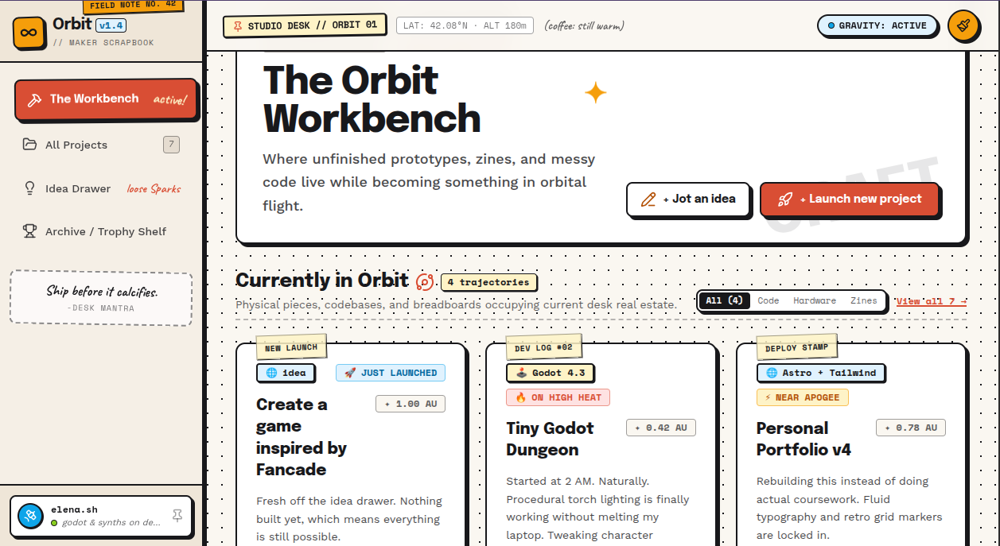

# Orbit 🪐

A tactile workbench for indie makers: where unfinished prototypes, zines, and messy code live while becoming something in orbital flight.

**Live demo:** https://orbit-ashen-sigma.vercel.app/

## What it does

- **Currently in Orbit:** zero-cover project cards with washi-tape labels and progress tracks, filterable by lane
- **Idea Drawer:** capture a stray idea in seconds, then promote it into a real project card
- **Launch new project:** a quick form that creates a card instantly
- **Recent Trajectories:** a log that writes itself as you work
- **Keyboard shortcuts:** `J` to jot an idea, `N` to launch a project
- Everything saves in your browser (localStorage), so no account and no backend

## Built with

React, Vite, Tailwind CSS v4, and Lucide icons. Designed in Stitch.

## Run it locally

    npm install
    npm run dev

## What's next

Project detail drawer, a command palette, a trophy shelf for shipped projects, and devlog export.